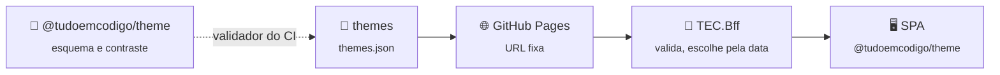

<div align="center">


[🏠 Tudo em Código](https://github.com/tudoemcodigo) › [🎄 themes](https://github.com/tudoemcodigo/themes)

# 🎄 themes

**Os temas sazonais do ecossistema TEC (Natal, por exemplo) como um único JSON validado: um PR aqui e todos os sistemas trocam a identidade visual, sem republicar nenhum.**

Manifesto JSON fechado · Contraste WCAG AA verificado · Deploy no GitHub Pages · Só o dono publica

[](https://github.com/tudoemcodigo/themes/actions/workflows/ci.yml)
[](https://tudoemcodigo.github.io/themes/themes.json)
[](https://github.com/tudoemcodigo/themes/blob/main/CHANGELOG.md)
[](https://github.com/tudoemcodigo/themes/blob/main/LICENSE)

[🚀 Início rápido](#-início-rápido) · [📚 Documentação](https://github.com/tudoemcodigo/themes/blob/main/docs/README.md) · [📝 Changelog](https://github.com/tudoemcodigo/themes/blob/main/CHANGELOG.md)

</div>

---

## 📑 Sumário

- [✨ Por que usar](#-por-que-usar)
- [📦 O que tem aqui](#-o-que-tem-aqui)
- [🧬 Ecossistema TEC](#-ecossistema-tec)
- [🚀 Início rápido](#-início-rápido)
- [📚 Documentação](#-documentação)
- [⚡ Compatibilidade](#-compatibilidade)
- [🛡️ Segurança · 🧪 Testes](#️-segurança--testes)
- [🤝 Contribuição · 🏷️ Versionamento · 📄 Licença](#-contribuição--versionamento--licença)

---

## ✨ Por que usar

| Sem o repositório de temas | Com o repositório de temas |
|---|---|
| Tema comemorativo exige novo build e deploy de N sistemas | Um PR; o `TEC.Bff` escolhe o tema pela data e os sistemas aplicam no próximo carregamento |
| Cor escolhida "no olho" pode reprovar no contraste | O CI calcula 24 pares de cores (WCAG AA, claro e escuro) e reprova o PR |
| Arquivo estranho misturado ao tema | Todo asset é conferido: tipo de verdade, tamanho e referência; órfão reprova |
| Data errada no calendário | Datas reais, `from <= to`, ids únicos e janelas agendadas com antecedência |

---

## 📦 O que tem aqui

| Item | Para que serve |
|---|---|
| [`themes.json`](https://github.com/tudoemcodigo/themes/blob/main/themes.json) | O documento de temas (contrato `1`): é o que o `TEC.Bff` busca |
| `assets/<id-do-tema>/` | Banner e logo do tema (PNG, WebP ou AVIF; SVG é proibido) |
| [`scripts/validate.mjs`](https://github.com/tudoemcodigo/themes/blob/main/scripts/validate.mjs) | O validador: esquema fechado, contraste, assets |
| `.github/workflows/` | `ci.yml` (valida todo PR) e `pages.yml` (publica no GitHub Pages) |

Tema em vigor hoje: `christmas-2026` (de 2026-12-01 a 2026-12-26, com neve).

---

## 🧬 Ecossistema TEC



Legenda: seta cheia = fluxo do dado; tracejada = o pacote fornece o validador usado no CI.

---

## 🚀 Início rápido

Requer Node 24 e um token com `read:packages` para instalar o validador (`@tudoemcodigo/theme`, do GitHub Packages).

```bash
export NODE_AUTH_TOKEN=<seu PAT com read:packages>   # nunca versione o token
npm install
npm run verify   # valida themes.json, contraste e assets, e roda os testes (14, cobertura de 100% do validador)
```

Para publicar um tema: edite `themes.json`, rode `npm run verify`, abra o PR. Depois do merge na `main`, o `pages.yml` publica. O passo a passo está em [Publicar um tema](https://github.com/tudoemcodigo/themes/blob/main/docs/publicar-tema.md).

> [!WARNING]
> **Não verificado:** a instalação do validador pelo registro só vale depois da publicação do pacote `@tudoemcodigo/theme`.

---

## 📚 Documentação

| Arquivo | O que responde |
|---|---|
| [📐 Publicar um tema](https://github.com/tudoemcodigo/themes/blob/main/docs/publicar-tema.md) | Do `themes.json` ao ar, passo a passo |
| [❌ Erros](https://github.com/tudoemcodigo/themes/blob/main/docs/erros.md) | Mensagem do validador, causa e correção |
| [🛡️ Segurança](https://github.com/tudoemcodigo/themes/blob/main/docs/seguranca.md) | Quem pode publicar e o que um tema não consegue fazer |

O manifesto em si (campos, regras, garantias) está documentado no [`lib-tec-web`](https://github.com/tudoemcodigo/lib-tec-web/blob/main/docs/tema-sazonal.md).

---

## ⚡ Compatibilidade

- **Node** 24; **navegadores**: os que o pacote `theme` suporta (verificado em Chromium, Firefox e WebKit).
- **Consumidor**: `TEC.Bff` com o endpoint `GET /bff/theme` (contrato `1`).

---

## 🛡️ Segurança · 🧪 Testes

- **Só o dono publica**: `main` protegida (PR obrigatório, check `ci-ok`), sem force-push nem exclusão.
- **O tema é dado, nunca código**: sem CSS, sem URL, sem script; tokens de erro, aviso e sucesso são protegidos.
- **Testes**: 14 (`node:test`), 100% de linhas, ramos e funções do validador; casos hostis: injeção de CSS, token protegido, asset SVG, travessia de caminho, arquivo renomeado, asset gigante e órfão.

---

## 🤝 Contribuição · 🏷️ Versionamento · 📄 Licença

- **Contribuição**: PR com `npm run verify` verde; só o dono publica temas.
- **Versionamento**: [SemVer 2.0](https://semver.org/lang/pt-BR/) para o repositório; o contrato do documento (`contract: 1`) muda por ADR.
- **Licença**: [Apache 2.0](https://github.com/tudoemcodigo/themes/blob/main/LICENSE) — consulte `NOTICE`.
