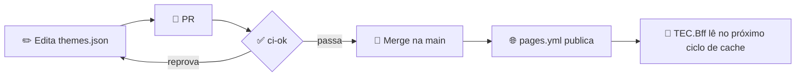

[🏠 themes](https://github.com/tudoemcodigo/themes/blob/main/README.md) › [📚 Documentação](https://github.com/tudoemcodigo/themes/blob/main/docs/README.md) › 📐 Publicar um tema

# 📐 Publicar um tema sazonal

> Para quem publica (hoje, só o dono). Leva alguns minutos e não exige deploy de nenhum sistema.

## 📑 Sumário

- [🧭 Visão geral](#-visão-geral)
- [📝 Passo a passo](#-passo-a-passo)
- [🎨 Escolher as cores](#-escolher-as-cores)
- [🕐 Agendar](#-agendar)
- [↩️ Tirar um tema do ar](#️-tirar-um-tema-do-ar)
- [❓ Perguntas frequentes](#-perguntas-frequentes)

## 🧭 Visão geral



Legenda: losango = decisão automática do CI.

## 📝 Passo a passo

1. Crie uma branch e adicione um item em `themes` no `themes.json` (copie o `christmas-2026` como base).
2. Se houver banner ou logo, coloque os arquivos em `assets/<id-do-tema>/` e referencie **só o nome do arquivo** em `assets`.
3. Rode `npm run verify`: valida o esquema, o contraste e os assets.
4. Abra o PR. O `ci-ok` precisa ficar verde.
5. Faça o merge. O `pages.yml` valida de novo e publica; o `TEC.Bff` passa a servir o tema dentro da janela.

Exemplo mínimo (só cores e neve, sem imagens):

```json
{
  "id": "christmas-2026",
  "from": "2026-12-01",
  "to": "2026-12-26",
  "tokens": {
    "color-accent": { "light": "#b3001b", "dark": "#ff9aa6" },
    "color-on-accent": { "light": "#ffffff", "dark": "#1a0004" }
  },
  "animation": "snow"
}
```

## 🎨 Escolher as cores

- Só `#rrggbb`, um par `light` e `dark` por token. Tokens de erro, aviso e sucesso **não** podem ser trocados.
- O validador mostra o par que reprova e a razão: por exemplo `contraste light color-accent/color-bg = 2.31 (mínimo 4.5)`. Ajuste a cor até passar.
- Teste claro **e** escuro; o alto contraste do usuário sempre vence o seu tema.

## 🕐 Agendar

`from` e `to` são datas inclusivas no fuso `America/Sao_Paulo`. Publique com antecedência: o tema só aparece dentro da janela. Com janelas sobrepostas vence o tema de **início mais recente**.

## ↩️ Tirar um tema do ar

Apague o item de `themes.json` (ou encurte o `to`) e faça o merge. Os sistemas voltam ao tema padrão no próximo ciclo de cache do `TEC.Bff`. Nada precisa ser republicado.

## ❓ Perguntas frequentes

**Posso usar uma fonte diferente?** Não: fontes não são trocáveis por tema.

**Posso colocar um SVG de logo?** Não: SVG é proibido. Use PNG, WebP ou AVIF de até 512 KiB.

**O que acontece se o Pages cair?** O `TEC.Bff` usa o último tema válido que já tinha em cache; sem cache, os sistemas ficam no tema padrão.

---

⬅️ [Índice](https://github.com/tudoemcodigo/themes/blob/main/docs/README.md) · ➡️ [Erros](https://github.com/tudoemcodigo/themes/blob/main/docs/erros.md)
